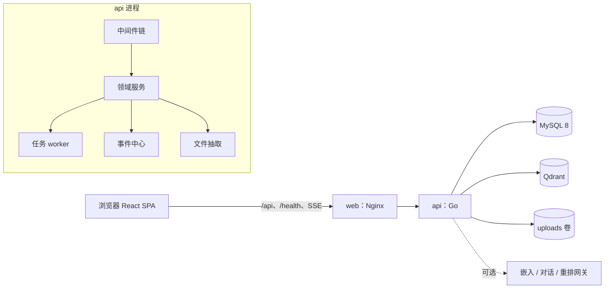

# CampusClaw 2.0 优化与扩展规划

基线是 `HanoFleet/teamwork` 的 `main`（提交 `4dd7ecc`，内容与 `HanoFleet/campusclaw` 相同）。本文只做规划，不改代码。按 `AGENTS.md`，每个模块动手前先写成 OpenSpec change，规约评审通过后再实现。

---

## 1. 项目题目

**CampusClaw 2.0：以班级知识库为底座的可追溯 AI 学习空间**

现在的 CampusClaw 是「教师上传 txt/md，本班检索和问答」的材料库。2.0 要把它做成一个班级学习空间：教师备课、发布、布置作业和练习，学生阅读、提问、交作业、复习错题，都在同一个班级里完成。AI 生成的每一句话都要能回到本班原文；资料里没有的，系统直接说没有。

### 1.1 现在已经有的

- 登录、教师/学生两种角色、按班级隔离；跨班与不存在同为 404。
- 教师上传 `.txt`/`.md`，材料行与知识库行同一事务写入。
- 切片入库（`auto`/`custom`/`hierarchy`），关键字、向量、混合三种检索，RRF 融合。
- `POST /api/ask` 先检索后生成，无切片不调模型，回答带 `[1]` 出处。
- 嵌入与对话都有 `local` 实现，离线可验收；换网关只改 `.env`。
- Compose 四个服务（web、api、db、qdrant），只有 web 映射宿主端口。
- `scripts/verify.py` 覆盖迭代 1、2 规约里的主要场景。

### 1.2 读代码发现的问题

| 问题 | 位置 | 对用户的影响 | 由哪个功能解决 |
| --- | --- | --- | --- |
| 上传请求里同步切片和嵌入，索引失败只写服务端日志 | `httpapi/materials.go` 上传末尾 | 大文件上传要等很久；教师看不到「能不能检索了」 | B2 |
| 重建索引先删旧切片和向量再写新的 | `retrieval/index.go` `IndexMaterial` | 重建期间这份材料检索不到；新嵌入失败时旧索引也没了 | B3 |
| 远程嵌入的 `Dim()` 固定返回 256 | `embed/embed.go` `HTTP.Dim` | 换成课程网关的真实模型（如 1024 维）后 Qdrant 写入失败 | B3 |
| 一次嵌入调用提交整份材料的所有切片 | `retrieval/index.go` | 长 PDF 会超过网关单次上限 | B2 |
| 限流 IP 取 `X-Forwarded-For` 第一段；Nginx 用 `$proxy_add_x_forwarded_for` 会保留客户端自带的值 | `httpapi/server.go` `clientIP`、`frontend/nginx.conf` | 攻击者每次换一个伪造 IP 就能绕过锁定 | A5 |
| 限流计数在内存里 | `auth/limiter.go` | 重启 api 计数清零 | A5 |
| 登录会删掉该用户全部旧会话 | `httpapi/auth.go` `login` | 手机和电脑不能同时在线 | A4 |
| 前端把 token 存进 `localStorage` | `frontend/src/api.ts` | 迭代 1 的 Decision 2 已否决这种做法：页面脚本能读到 | E7 |
| 正式页面里写死了 `class_id: 999` 和一条伪造的 `system` 消息 | `App.tsx` 上传、检索、提问；`Ask.tsx` | 演示隔离用的代码留在了产品界面里 | E7 |
| 问答页的引用只能回到材料列表；对话不带历史，刷新就丢 | `Ask.tsx` | 看不到依据在原文哪里；不能追问 | C1、C4、B7 |
| `custom` 策略的偏移相对预处理后的文本 | `chunk/chunk.go` | 没法在原文上高亮引用位置 | B7 |
| 只支持 txt/md；没有删除、改名、编辑、分类、分页 | 上传与列表接口 | 教师手里的 PDF、Word、PPT 进不来，材料多了找不到 | B1、B4、B5、B6 |
| 讲义、作业、助手、技能四张表只是占位 | `db/db.go` | 没有教学互动 | C5、C6、D1–D5 |
| 只有 3 个种子账号，不能注册、加人、改口令 | `db/db.go` `Seed` | 真实班级用不起来 | A1–A4 |
| JWT Bearer 已经实现，规约和 `openspec/config.yaml` 仍写着不引入 JWT | 提交 `4dd7ecc` | 规约与实现不一致 | E7 |
| 迁移只有 `CREATE TABLE IF NOT EXISTS` | `db/db.go` `Migrate` | 之后加列、改列无处表达 | E1 |
| 前端主要逻辑都在 629 行的 `App.tsx` 里，没有前端测试和 CI | `frontend/src` | 功能一多就难改，回归靠人工 | E5、E8 |

### 1.3 目标

体验目标（用 Playwright 和人工走查验收）：

- 教师从拿到账号到学生能问到新讲义，不超过 5 步：登录、建邀请码、学生注册、拖入文件、等索引变绿。
- 上传后不刷新页面也能看到每个文件的抽取和索引进度。
- 回答先出依据卡片，再逐字输出；点任意 `[n]` 都能打开原文并高亮那一段。
- 学生打开首页，第一屏能看到全部待办：未交作业、未做练习、待复习错题、新公告。
- 375px 宽的手机上能完成阅读、提问、交作业、做练习；全部功能只用键盘也能操作；深浅两种主题都满足 WCAG AA 对比度。
- 本地模式下，列表接口 p95 小于 200 ms，问答首字小于 2 s。

工程目标：

- 新增的每类资源都进入隔离矩阵测试：跨班、跨人、不存在三种情况的响应必须同形。
- 所有 AI 能力都有 `local` 实现，没有任何外部密钥时 `verify.py` 和 CI 也能全绿。
- 每个模块对应一个 OpenSpec change，实现后归档，`openspec/specs/` 与代码一致。

### 1.4 不变的底线

下面几条是现有系统的安全承诺，2.0 的每个功能都不能破坏：

1. 班级只来自服务端会话。多班切换也只是由服务端核对成员关系后改写会话里的当前班级，请求里的 `class_id` 一律丢弃。
2. 跨班、不存在、无权访问他人私有数据，对外都是同形 404；只在服务端日志里区分。
3. 没有依据不生成。所有 AI 输出（回答、总结、题目）都带出处；没有可用切片时返回固定文案，不调用对话模型。
4. Qdrant 和模型网关不暴露到宿主，密钥只在服务端环境变量里。
5. 标准启动方式只有 Compose，只有 web 映射端口。
6. `/health` 不查数据库；数据库不可用时业务接口返回 503。
7. 上传要么全部写入，要么什么都不留。
8. 授权在 Go 服务端判断，前端隐藏按钮不算授权。
9. 不做可以跨班查看的平台超级管理员。账号兜底操作走容器内命令行。
10. 练习的答案和解析在学生提交之前不下发到浏览器。

### 1.5 这一轮不做

- 平台超级管理员和任何跨班查看能力。
- AI 自动给作业打分。作业由教师批改，AI 只用于有出处的学习辅助和出题草稿。
- 校园 SSO / OAuth、短信邮件找回口令。口令由教师重置。
- 扫描件 OCR、音视频材料。
- 多人实时协同编辑。编辑冲突用版本号检测。
- 多副本部署和对象存储。代码会在成本低的地方做到多实例安全（限流和队列放 MySQL），但交付仍是单 api。
- 原生移动 App，只做响应式网页。

---

## 2. 主要功能

功能分五个模块，每个模块由一名工程师负责前后端。优先级的含义：P0 是 2.0 发布必须有的；P1 应当有；P2 在进度允许时做，砍掉也不影响主路径。

### 2.1 两条主路径

**教师**：首次登录看到三步引导 → 在班级管理页生成邀请码，把二维码投到大屏 → 把一批 PDF、Word、PPT 拖进材料页，看着每个文件从「抽取中」变成「可检索」 → 把讲义编排进「第一单元」 → 选中讲义点「生成练习」，改两道题后发布 → 布置作业 → 首页看到提交率，以及「学生问了但资料里没有」的问题 → 补一份材料 → 批改作业，学生收到通知。

**学生**：扫码打开注册页，填用户名和口令，直接进入班级 → 首页看到待交作业倒计时和新公告 → 按学习路径打开讲义，下次自动回到上次读到的位置 → 读到不懂的地方选中文字点「讲解」，或点「就这份材料提问」 → 回答先列出依据，再逐字出现，点 `[1]` 跳到原文高亮处 → 做练习，提交后立刻看到对错、解析和出处 → 错题进错题本，复习时连续答对两次算掌握 → 交作业，收到批改结果通知。

### 2.2 功能总览

| 模块 | 编号 | 功能 | 优先级 | 人日 |
| --- | --- | --- | --- | --- |
| A 账号、班级与安全 | A1 | 班级成员关系与多班切换 | P0 | 4 |
| | A2 | 邀请码加入与自助注册 | P0 | 3 |
| | A3 | 批量导入、重置口令、首次登录改口令 | P1 | 2 |
| | A4 | 个人设置、多设备在线与设备管理 | P0 | 2 |
| | A5 | 登录防护修正（来源 IP、持久化计数） | P0 | 2 |
| | A6 | 班级操作审计 | P1 | 2 |
| | A7 | 班级管理页 | P0 | 3 |
| | A8 | 偏好同步与新手引导 | P2 | 1 |
| | — | 联调、隔离测试与规约 | — | 1 |
| B 材料与知识库 | B1 | PDF / Word / PPT 上传与页码 | P0 | 4 |
| | B2 | 拖拽批量上传与异步索引进度 | P0 | 3 |
| | B3 | 原子重建索引与嵌入模型切换 | P0 | 1 |
| | B4 | 在线编辑与版本历史 | P1 | 3 |
| | B5 | 删除、撤销与回收站 | P0 | 2 |
| | B6 | 目录、标签、排序、筛选、分页与批量操作 | P1 | 3 |
| | B7 | 阅读体验：大纲、引用定位高亮、阅读进度、收藏 | P0 | 3 |
| | — | 联调、隔离测试与规约 | — | 1 |
| C 智能问答与学习助手 | C1 | 多轮会话与历史 | P0 | 3 |
| | C2 | 流式回答、停止与重新生成 | P0 | 3 |
| | C3 | 追问改写、限定范围、推荐问题 | P0 | 2 |
| | C4 | 出处校验与一键跳转 | P0 | 1 |
| | C5 | 班级助手配置 | P1 | 2 |
| | C6 | 学习技能：总结、讲解、提纲、出题 | P1 | 4 |
| | C7 | 回答反馈与知识缺口 | P0 | 2 |
| | C8 | 可选重排与检索评测 | P2 | 2 |
| | — | 联调、隔离测试与规约 | — | 1 |
| D 教学互动 | D1 | 课程单元与学习路径 | P1 | 3 |
| | D2 | 作业发布、提交与批改 | P0 | 6 |
| | D3 | 练习与自动判分 | P1 | 4 |
| | D4 | 错题本 | P1 | 2 |
| | D5 | 公告与通知中心 | P0 | 3 |
| | — | 联调、隔离测试与规约 | — | 2 |
| E 平台底座与体验框架 | E1 | 版本化数据库迁移 | P0 | 2 |
| | E2 | 中间件链与后端分层 | P0 | 3 |
| | E3 | 后台任务队列 | P0 | 2 |
| | E4 | 实时事件通道 | P0 | 2 |
| | E5 | 前端应用外壳、组件库、全局搜索 | P0 | 4 |
| | E6 | 首页仪表盘与学情统计 | P1 | 3 |
| | E7 | 安全加固与规约补齐 | P0 | 1 |
| | E8 | CI、端到端测试、备份恢复、演示数据 | P0 | 3 |
| **合计** | | | | **100** |

每个模块 20 人日，5 人 × 4 周 = 100 人日。

### 2.3 模块 A：账号、班级与安全

**A1 班级成员关系与多班切换（P0）**

- 一位教师可以带多个班。顶栏的班级切换器只列出本人所属的班级，切换后整个页面换成该班的数据，URL 里不出现班级。
- 学生只属于一个班。
- 教师可以新建班级（名称、简介），建好后自动成为该班教师。
- 当前班级是 A 时，访问 C 班的材料仍然 404，即使这位教师也带 C 班；要先切换。
- 验收：切换到不属于自己的班级返回 404，响应与不存在的班级相同；成员关系被移除后，旧会话的下一次请求返回 401；命令面板只列本人所属班级。

**A2 邀请码加入与自助注册（P0）**

- 教师生成邀请码时选角色（学生或协作教师）、有效期（1 天、7 天、30 天）和使用次数上限。页面同时给出 8 位码、加入链接和可投屏的二维码。
- 学生打开 `/register?code=…`，填用户名、显示名和口令，提交后直接进入班级并处于登录状态。
- 已有账号的教师在「加入班级」里输入码，就能加入新班。学生已经有班级时，加入另一个班会被拒绝。
- 码不存在、已过期、已撤销、已用完，四种情况返回同一个 400 和同一段提示，不区分原因。
- 教师可以随时撤销邀请码，并能看到每个码已经用了几次。

**A3 批量导入、重置口令、首次登录改口令（P1）**

- 教师下载 CSV 模板（用户名、显示名），上传后先看预览：逐行标出新建、重名、格式错误，确认后才创建。单次最多 200 行。
- 初始口令由服务端随机生成，只在本次导入结果的 CSV 里出现一次，不入库，不写日志。
- 教师可以重置本班学生的口令：生成临时口令，该学生所有设备立即下线，下次登录必须先改口令。
- 教师可以把学生移出班级，移出后该学生的会话立即失效。

**A4 个人设置、多设备在线与设备管理（P0）**

- 修改显示名；修改口令需要先输入旧口令，改完后其他设备全部下线。
- 同一账号最多 5 个设备同时在线，超出时挤掉最早的会话。每次登录仍然换发新的会话 id，同一浏览器的旧会话会被删除。
- 设备管理页列出在线会话：浏览器类型、IP 网段、最近活跃时间。可以单独下线某台设备，也可以一键下线其他全部设备。

**A5 登录防护修正（P0）**

- 来源 IP 只采信 Nginx 写入的 `X-Real-IP`，并且只在请求确实来自受信代理网段时才采信。客户端自带的 `X-Forwarded-For` 不再参与限流。
- 失败计数存 MySQL，api 重启不清零。
- 除了「用户名 + IP」，同一用户名跨 IP 的失败次数另设一个更高的阈值，防止换 IP 分布式猜口令。
- 锁定期内的响应仍与口令错误完全相同（401、同一响应体），不返回 429。
- 注册和加入班级接口按 IP 限速。

**A6 班级操作审计（P1）**

- 教师在班级管理页查看本班操作记录：谁在什么时候上传、编辑、删除、恢复了材料，重建索引，生成或撤销邀请码，移出成员，重置口令，发布作业，批改。
- 可以按操作类型和操作人筛选，导出 CSV。学生看不到审计。

**A7 班级管理页（P0）**

- 成员页签：成员列表（搜索、角色、最近登录），从这里进入单个学生的学情（E6）。
- 邀请页签：生成、复制、二维码、撤销、使用次数。
- 导入页签（A3）和审计页签（A6）。
- 所有危险操作（移出成员、重置口令、撤销邀请码）都要二次确认。

**A8 偏好同步与新手引导（P2）**

- 主题、列表或网格视图、侧栏是否折叠这些偏好存到服务端，换设备后保持一致。
- 首次登录时按角色给出三步引导：教师是「建邀请码 → 上传材料 → 发布作业」，学生是「看首页待办 → 打开材料 → 试着提问」。可以跳过，看过之后不再出现。

### 2.4 模块 B：材料与知识库

**B1 PDF / Word / PPT 上传与页码（P0）**

- 新增支持 `.pdf`、`.docx`、`.pptx`，原有的 `.txt`、`.md` 不变。
- PDF 的引用显示第几页，PPT 的引用显示第几张幻灯片。Word 里的标题样式转成 Markdown 标题，所以 `hierarchy` 切分可以直接按章节切。
- 扫描版 PDF、加密 PDF、损坏的文件都要当场给出原因，例如「这个 PDF 里没有可复制的文字，可能是扫描件」。失败时不留下材料行和文件。
- 上传上限按格式分开配置：文本类保持现在的上限，PDF 和 PPT 可以放宽到 20 MiB。

**B2 拖拽批量上传与异步索引进度（P0）**

- 可以把多个文件直接拖到材料页。页面上出现一个上传队列面板，每个文件有自己的进度条和状态：上传中、抽取中、排队索引、索引中、可检索、失败。
- 失败的文件显示原因，可以重试或移出队列。关掉面板，上传仍在后台继续。
- 状态通过事件通道实时更新，不用刷新页面。
- 材料列表上每份材料都有索引状态徽标。教师可以展开看切片预览：每片的文本、页码和状态。
- 嵌入改为每批 32 条，长文档不会超出网关的单次上限。

**B3 原子重建索引与嵌入模型切换（P0）**

- 重建索引期间，旧索引照常可以检索。新索引全部写好之后才切换；新索引失败时，旧索引不受影响。
- 修正远程嵌入维度：维度从配置读取，Qdrant 集合名带上维度。
- 换嵌入模型后，教师可以对本班「全部重建」，并能看到进度。

**B4 在线编辑与版本历史（P1）**

- `.md` 和 `.txt` 可以在线编辑：左边编辑，右边实时预览，草稿自动保存在本地。保存时可以填修改说明，保存后生成新版本，并自动重建索引。
- 两位教师同时编辑同一份材料时，后保存的人会收到冲突提示，可以先看差异，再决定覆盖还是放弃。
- PDF、Word、PPT 支持「替换文件」，同样生成新版本。
- 版本历史页：版本列表、任意两版的差异对比、恢复到某一版。恢复会生成一个新版本，不改写历史。

**B5 删除、撤销与回收站（P0）**

- 删除后 5 秒内，提示条上可以点「撤销」。
- 删除的材料进回收站，保留 30 天，期间可以恢复或彻底删除；30 天后由定时任务清理文件、数据行和向量。
- 删除后，本班学生的列表、详情、检索和问答立即看不到这份材料。详情返回 404，和不存在相同。
- 支持批量删除。

**B6 目录、标签、排序、筛选、分页与批量操作（P1）**

- 两级目录（例如「第一章 / 讲义」）、彩色标签、置顶。
- 排序：最新上传、标题、最近更新。筛选：目录、标签、格式、索引状态。每页 20 条分页。
- 批量移动、批量打标签。

**B7 阅读体验（P0）**

- 材料详情左侧是大纲（按标题生成，点击跳转）。可以在排版视图和原文视图之间切换。PDF 和 PPT 在正文里显示页码分隔线。
- 从检索结果或问答引用进来时，自动滚动到对应段落并高亮，显示「切片 3 · 第 5 页」。同一份材料被引用了多处时，可以跳到上一处或下一处。
- 学生侧会记住读到哪里，下次打开回到原位置；显示阅读进度；支持收藏和最近浏览。
- 详情页有「就这份材料提问」按钮，点了进入问答，范围默认限定为这份材料。
- 所有策略的切片偏移都指向原文位置，`custom` 预处理之后也能在原文上高亮。

### 2.5 模块 C：智能问答与学习助手

**C1 多轮会话与历史（P0）**

- 问答页左侧是会话列表，按今天、7 天内、更早分组。可以新建、重命名、删除、搜索会话。
- 刷新或换设备都不丢。会话只有本人能看，教师也看不到学生的会话。
- 第一个问题自动生成会话标题。

**C2 流式回答、停止与重新生成（P0）**

- 回答分两步出现：先显示「在本班 3 份材料中找到 4 处依据」和依据卡片，再逐字输出回答。
- 生成过程中可以停止；也可以对某条回答重新生成、复制，或修改上一个问题后重发。
- 模型网关超时或出错时，明确告诉用户是服务暂时出了问题（而不是「资料里没有」），并提供一键重试。

**C3 追问改写、限定范围、推荐问题（P0）**

- 追问「那它的反例呢？」时，系统先结合上一轮把它改写成完整问题，再去检索。回答下方可以展开查看「实际检索的问题」。
- 提问范围可选：全部材料、某个目录、某个标签、指定的几份材料。从材料页或单元页进来时，范围默认就是那份材料或那个单元。
- 空会话里显示推荐问题：一部分是助手配置的，一部分根据本班材料的标题生成。

**C4 出处校验与一键跳转（P0）**

- 回答里的 `[1]`、`[2]` 显示成角标。悬停时预览摘录，点击后打开材料并高亮对应段落。
- 服务端校验编号：超出依据数量的编号直接去掉。模型一个出处都没有标时，回答上方提示「此回答未标注出处，请对照依据核实」。
- 被引用的材料后来改过，引用卡片会提示「原文已更新」，并显示当时的摘录；材料被删除了，显示「材料已删除」。

**C5 班级助手配置（P1）**

- 教师为本班配置助手：名称、头像（emoji）、开场白、回答风格（简洁、详细、引导式提问）、推荐问题、可用的技能。
- 一个班可以配多个助手，比如「数学答疑」和「实验安全」，每个助手可以限定只用某些目录或标签里的材料。
- 学生在问答页选择要用哪个助手。

**C6 学习技能（P1）**

- 总结要点：对选中的材料生成分条要点，每条都带出处。
- 概念讲解：在材料页选中一段文字，点浮动按钮「讲解」，用更浅显的话解释这一段，并给出出处。
- 学习提纲：按材料的标题结构生成复习提纲。
- 生成练习：从材料生成单选、判断、填空题草稿，每道题带出处，交给教师编辑后发布（D3）。
- 都遵守「没有依据不生成」：选中的材料没有可用切片时，直接说明，不调模型。

**C7 回答反馈与知识缺口（P0）**

- 每条回答都可以点「有用」或「没用」。点「没用」时选原因：答非所问、出处不对、资料里有但没找到、其他。
- 教师的「知识缺口」页列出本班最近 30 天里没有命中的问题和被点了「没用」的回答，相同的问题合并计数。只显示问题，不显示是哪个学生问的。
- 每个缺口旁边有「上传补充材料」按钮，补完可以直接用这个问题重新试一次。

**C8 可选重排与检索评测（P2）**

- 支持可选的重排网关，默认关闭。开启后先取 20 条候选，重排后取前 4 条。
- 教师可以打开「检索详情」，看到每条命中的关键字分、向量分和融合名次。
- 建一套检索评测集和评测脚本，把三种模式的 recall@4 和 MRR 写进文档，作为以后调阈值、换模型的依据。

### 2.6 模块 D：教学互动

**D1 课程单元与学习路径（P1）**

- 教师把材料、练习、作业编排进单元（例如「第一单元 函数」），单元有简介、顺序和发布时间，支持定时发布。
- 学生看到的学习路径是一列单元卡片，每张显示完成度（已读材料数 / 总数、练习是否完成）。未发布的单元学生看不到，按 id 访问返回 404。
- 单元页里有「本单元问答」，提问范围限定为这个单元里的材料。

**D2 作业发布、提交与批改（P0）**

- 教师创建作业：Markdown 说明、关联材料、截止时间、是否允许迟交、满分。作业有草稿、已发布、已截止三种状态，发布时通知全班。
- 学生的作业列表按截止时间排序，显示倒计时。可以在线写答案（Markdown），也可以上传文件（txt、md、pdf、docx，校验规则沿用 B1）。截止前可以多次提交，每次提交都留版本；草稿自动保存。
- 教师批改：提交列表可以按已交、未交、迟交筛选；逐份打分、写评语，用上一份/下一份快速切换。批改完成后学生收到通知。成绩可以导出 CSV。
- 学生只能看到自己的提交，访问别人的提交返回 404。

**D3 练习与自动判分（P1）**

- 教师可以从材料一键生成题目草稿（C6），也可以手动出题。题型有单选、多选、判断、填空，每道题可以写解析，并关联出处。
- 练习可以设置是否允许重做、是否限时。
- 学生提交后立即判分，这时才看到正确答案、解析和「出处」链接；点出处跳到原文高亮处。
- 教师可以看每道题的正确率和每个学生的得分。

**D4 错题本（P1）**

- 答错的题自动进入错题本，按单元和材料分组。
- 复习模式下重新作答，连续答对两次标记为已掌握。
- 每道错题都有「回到原文」和「问助手这道题」两个入口。

**D5 公告与通知中心（P0）**

- 教师可以发布公告，可以置顶。
- 通知类型：作业发布、作业将在 24 小时内截止、作业已批改、练习发布、新公告。
- 顶栏铃铛实时显示未读数，可以全部标为已读。截止提醒由定时任务生成。

### 2.7 模块 E：平台底座与体验框架

**E1 版本化数据库迁移（P0）**：之后每个模块都要加表加列。用户感知不到，但升级时不需要清空数据卷。

**E2 中间件链与后端分层（P0）**：请求 id、结构化日志、统一鉴权、角色守卫、错误处理。新接口不会再漏掉班级或角色校验。

**E3 后台任务队列（P0）**：索引、删除向量、清理回收站、截止提醒、通知分发都放进队列。上传请求马上返回，失败会自动重试。

**E4 实时事件通道（P0）**：索引进度、新通知、材料变化推到浏览器，页面不用轮询或手动刷新。

**E5 前端应用外壳、组件库、全局搜索（P0）**

- 左侧导航加顶栏（班级切换、全局搜索、通知、头像菜单）。窄屏时导航变成底部标签栏。
- 全局搜索（Ctrl/⌘ + K）同时搜材料、作业、练习、单元和命令，可以用键盘上下选择。
- 统一的加载骨架、空状态（告诉用户下一步可以做什么）、可重试的错误提示、确认对话框、可撤销的提示条。
- 登录过期时弹出登录框，重新登录后回到原来的页面，正在写的作业和问题不丢。
- 断网时顶部出现提示条；遇到 503 时提示「服务暂时不可用」并自动重试。
- 保留北大红主色和深浅主题；保证键盘可达和焦点可见。

**E6 首页仪表盘与学情统计（P1）**

- 教师首页：本班材料数和索引异常数、本周提问数和未命中率、待批改作业、知识缺口前 5 条、最近活动。
- 学生首页：继续阅读、待交作业（按截止时间排序）、未完成的练习、待复习错题、最新公告、推荐问题。
- 学情表：本班每个学生的已读材料数、作业提交情况和成绩、练习平均分、最近活跃时间，可以导出 CSV。

**E7 安全加固与规约补齐（P0）**：前端只用 HttpOnly Cookie；去掉正式页面里的演示代码；补上 CSP 和 Origin 校验；AI 接口按用户限速；把已经实现的 Bearer 令牌写进规约。

**E8 CI、端到端测试、备份恢复、演示数据（P0）**：每次推送自动跑单元测试、构建、Compose 启动和 `verify.py`；一键备份和恢复；提供一套演示数据，打开就能看到完整效果。

---

## 3. 技术方案

### 3.1 总体架构

链路保持不变：浏览器只访问 Nginx，Nginx 反代 `/api` 与 `/health` 到 Go，Go 访问 MySQL、Qdrant 和可选的模型网关。新增的部分都在 api 进程内部：任务 worker、事件中心和文件抽取。



Compose 仍然是 web、api、db、qdrant 四个服务。api 镜像多装一个 `poppler-utils`，用来抽取 PDF 文字。

### 3.2 后端结构

继续用 Go 标准库 `net/http` 的 `ServeMux`。新增依赖只有一个外部二进制 `pdftotext`；Word 和 PPT 用标准库 `archive/zip` 加 `encoding/xml` 解析。

```text
backend/
  cmd/server/main.go        启动、迁移、种子、worker、优雅退出
  cmd/server/admin.go       容器内子命令：create-teacher、reset-password、reindex-all
  internal/
    httpapi/                路由和处理函数，按领域拆文件
    middleware/             请求 id、日志、恢复、鉴权、角色、Origin、限速
    auth/                   会话、口令、JWT、MySQL 限流
    accounts/               用户、成员、邀请、导入、偏好
    audit/                  审计写入与查询
    materials/              上传校验、版本、回收站、目录标签
    extract/                txt / md / pdf / docx / pptx 抽取与页码表
    chunk/                  已有；增加原文偏移映射
    retrieval/              已有；范围过滤、原子重建、可选重排
    conversation/           会话、消息、改写、流式、出处校验
    assistant/              助手和技能
    teaching/               单元、作业、提交、练习、错题
    notify/                 公告、通知、事件中心
    jobs/                   任务队列与 worker
    stats/                  仪表盘与学情聚合
    db/migrations/          NNNN_xxx.sql，embed 进二进制
```

处理函数只负责解析请求和写响应。班级和用户从中间件放进 `context` 的 `*User` 里取，领域服务的每个函数都显式接收 `classID`，SQL 里一定带这个条件。

### 3.3 关键设计决策

**决策 1：当前班级写在会话里，由服务端核对成员关系**

做法：新增 `class_members(class_id, user_id, role)`，`sessions` 增加 `active_class_id`。登录时把当前班级设为 `users.class_id`（主班级）。切换班级调用 `POST /api/session/class`，服务端确认本人是该班成员后，才改写会话行。每次请求的 `currentUser` 都联表 `class_members`；成员关系被删掉之后，会话立即失效。现有 SQL 用的 `u.ClassID` 改为取 `active_class_id`，原有查询基本不用改。

备选：每个请求自带 `class_id`，服务端再核对成员关系。否决。这等于把租户重新交给调用方，每个接口都得记得核对，漏一处就越权。

**决策 2：版本化迁移**

做法：`internal/db/migrations/NNNN_name.sql` 通过 `embed.FS` 打进二进制，`schema_migrations` 记录已经执行的版本。`0001` 就是现在全部的 `CREATE TABLE IF NOT EXISTS`，在已有库上执行没有副作用，所以现有部署不清卷也能升级。MySQL 的 DDL 会隐式提交，所以一个文件只做一件事，加列前先查 `information_schema`，保证可以重复执行。

备选：引入 golang-migrate。可以用，但本项目的迁移量小，自己写大约百行就够，少一个依赖。

**决策 3：MySQL 任务表加进程内 worker**

做法：新增 `jobs` 表。api 启动两个 worker goroutine，在事务里用 `SELECT … FOR UPDATE SKIP LOCKED` 领取任务（MySQL 8 支持）。失败按指数退避重试，最多 5 次；`running` 状态超过 10 分钟视为卡死，重新排队。任务类型有 `index_material`、`reindex_class`、`delete_vectors`、`purge_trash`、`due_reminders`、`fanout_notification`。入队和业务写入在同一个事务里，不会出现「材料写进去了，任务却没写」。截止提醒和回收站清理这类定时任务，由 worker 每分钟检查一次，按「任务类型 + 时间窗口」做唯一键入队，重复入队会被唯一键挡住。

备选：Redis 或 RabbitMQ。否决。为几种低频任务多加一个容器不划算，而且没法和业务写入放进同一个事务。

**决策 4：上传时同步抽取文字，索引放到后台**

做法：抽取文字在上传请求里完成，`pdftotext` 设 30 秒超时，并限制输出大小。抽取成功后，文件、`materials`、`knowledge_entries`、`material_versions`、`jobs` 一个事务写入，然后立即返回 201 和 `index_status: pending`。切片和嵌入由 worker 完成，每批 32 条。这样「上传要么全有要么全无」仍然成立。

备选：抽取也放进队列。否决。扫描件、加密 PDF 这类失败应该当场告诉教师，而不是先留下一条注定失败的材料。

**决策 5：原子重建索引**

做法：`knowledge_chunks` 增加 `generation`，`materials` 增加 `active_generation`。重建时，新切片用新的 generation、以 `pending` 状态写入，向量写进 Qdrant。全部成功后，在一个事务里把新切片标为 `ready`、删除旧切片行、更新 `active_generation`，最后再删旧向量。中途失败就删掉新切片和新向量，旧索引原样可用。检索 SQL 本来就只查 `ready`，回表时又核对一次，所以重建期间检索不会中断。

**决策 6：引用偏移一律指向原文**

做法：预处理时同时生成「预处理后下标 → 原文下标」的映射表，`start_offset` 和 `end_offset` 一律存原文的码点下标。PDF 和 PPT 在抽取时记录每页的起始偏移，存进 `knowledge_entries.page_offsets`，切片据此算出 `page_from` 和 `page_to`。前端用 `Array.from(body)` 按码点切分，避免中文以外的字符（例如 emoji）因为 UTF-16 代理对而错位。

**决策 7：出处存原文区间，不存切片 id**

做法：消息的 `citations` 和题目的出处都存 `material_id`、版本号、原文区间和当时的摘录快照。重建索引会换切片 id，但原文区间不变；材料改版后，前端比对版本号，提示「原文已更新」。

**决策 8：流式回答用 SSE，原有非流式接口保留**

做法：`POST /api/conversations/{id}/messages` 在请求头 `Accept: text/event-stream` 时用 SSE 返回，事件依次是 `citations`、若干 `delta`、`done`，出错时是 `error`；其他情况下返回 JSON。Go 用 `http.Flusher` 推送，响应头带 `X-Accel-Buffering: no`，让 Nginx 不缓冲。浏览器用 `fetch` 加 `ReadableStream` 解析（`EventSource` 不支持 POST）。客户端断开时 `context` 取消，上游网关请求随之取消，消息记为 `stopped`。没有切片时只发空的 `citations` 和固定文案的 `done`，不调网关。`POST /api/ask` 保持现在的非流式行为，curl 和 `verify.py` 照常可用。

备选：WebSocket。否决。这里只需要服务端单向推送，SSE 走普通 HTTP，Nginx 和鉴权都不用改。

**决策 9：事件通道**

做法：`GET /api/events` 是每个用户一条 SSE 长连接，进程内的事件中心按 `user_id` 分发。事件有 `job.updated`、`notification.created`、`material.changed`，每 15 秒发一次心跳，只推当前班级的事件；切换班级后前端重新连接。和现在一样只部署一个 api。以后要多实例时，把事件中心换成 MySQL 轮询或 Redis 发布订阅，接口不变。

**决策 10：每个 AI 能力都有本地实现**

做法：每个 AI 能力都是一个 Go 接口，配两份实现：`local` 是确定性的、离线的，用于验收；`http` 走 OpenAI 兼容网关。

| 能力 | `local` 实现 | `http` 实现 |
| --- | --- | --- |
| 嵌入 | 现有 ngram 哈希向量 | `/embeddings`，维度取 `EMBEDDING_DIM` |
| 回答 | 现有摘录式；流式时按句切成多段推送 | `/chat/completions`，`stream: true` |
| 追问改写 | 问句短或含指代词时，拼上上一轮的问句 | 让模型输出一个独立问句，只用于检索 |
| 总结、提纲 | 按标题结构和句子位置挑选原句 | 带编号依据的提示词 |
| 概念讲解 | 返回被选中段落及其相邻句 | 带编号依据的提示词 |
| 出题 | 从关键句挖空生成填空题，从「是/不是」句生成判断题 | 按 JSON Schema 输出，服务端校验，失败重试一次 |
| 重排 | 原样返回 | `/rerank` |

所有实现都遵守同一条规则：先检索，没有切片就返回固定文案，不调用生成。

**决策 11：学生私有数据只对本人可见**

做法：会话、消息、阅读进度、收藏、错题只对本人可见，别人访问一律 404。提交和练习记录对本人和本班教师可见。教师看提问情况只能通过 `question_logs` 的匿名聚合，接口不返回 `user_id`。

**决策 12：练习答案只在服务端**

做法：学生端的题目接口不返回 `answer` 和 `explanation`。学生提交后，服务端判分，再在提交结果里返回答案、解析和出处。限时练习按服务端记录的 `started_at` 计时。

**决策 13：网页只用 Cookie，Bearer 留给脚本**

做法：`POST /api/login` 继续在响应里返回 Bearer 令牌，供 curl 和脚本使用；前端不再把它写进 `localStorage`，只依赖 HttpOnly Cookie。令牌的 `sub` 是会话 id，登出、改口令、设备下线后都立即失效。这一行为补写进 `auth-upload` 规约。

**决策 14：来源 IP 只采信受信代理**

做法：Nginx 改为 `proxy_set_header X-Real-IP $remote_addr`，并用 `$remote_addr` 覆盖 `X-Forwarded-For`，不再追加。Go 只在 `RemoteAddr` 落在 `TRUSTED_PROXY_CIDRS` 里时才读 `X-Real-IP`，否则用 `RemoteAddr`。限流表的键是 `sha256(用户名|IP)`，另有一条按用户名统计的记录。

### 3.4 数据模型

| 表 | 新增 / 修改 | 关键字段 |
| --- | --- | --- |
| `schema_migrations` | 新增 | `version`、`applied_at` |
| `users` | 修改 | 增加 `display_name`、`must_change_password`、`created_at`、`last_login_at`；`class_id` 作为主班级保留 |
| `sessions` | 修改 | 增加 `active_class_id`、`user_agent`、`ip_prefix`、`last_seen_at` |
| `classes` | 修改 | 增加 `title`、`description`、`created_by`、`created_at` |
| `class_members` | 新增 | 主键 `(class_id, user_id)`、`role`、`joined_at` |
| `class_invites` | 新增 | `class_id`、`code_hash`、`role`、`max_uses`、`used_count`、`expires_at`、`revoked_at`、`created_by` |
| `login_failures` | 新增 | `key_hash`、`fail_count`、`locked_until`、`updated_at` |
| `user_prefs` | 新增 | `user_id`、`prefs` JSON、`onboarded_at` |
| `audit_logs` | 新增 | `class_id`、`actor_id`、`action`、`target_type`、`target_id`、`meta` JSON、`created_at` |
| `jobs` | 新增 | `kind`、`class_id`、`ref_id`、`dedupe_key`（唯一，可空）、`payload` JSON、`status`、`attempts`、`run_after`、`locked_at`、`last_error` |
| `materials` | 修改 | 增加 `folder_id`、`description`、`mime`、`page_count`、`current_version`、`active_generation`、`index_status`、`pinned`、`updated_at`、`deleted_at`、`deleted_by` |
| `knowledge_entries` | 修改 | 增加 `version`、`page_offsets` JSON；`body` 是当前版本的原文或抽取文本 |
| `knowledge_chunks` | 修改 | 增加 `generation`、`page_from`、`page_to`；偏移改为原文下标 |
| `material_versions` | 新增 | `material_id`、`version`、`storage_name`、`body`、`byte_size`、`editor_id`、`note`、`created_at` |
| `folders` | 新增 | `class_id`、`parent_id`、`name`、`sort` |
| `tags`、`material_tags` | 新增 | `class_id`、`name`、`color`；关联表 |
| `material_reads` | 新增 | `user_id`、`material_id`、`position`、`progress`、`last_read_at` |
| `favorites` | 新增 | `user_id`、`material_id`、`created_at` |
| `conversations` | 新增 | `class_id`、`user_id`、`assistant_id`、`title`、`scope` JSON、`created_at`、`updated_at`、`deleted_at` |
| `messages` | 新增 | `conversation_id`、`role`、`content`、`rewritten_query`、`citations` JSON、`status`、`grounded`、`latency_ms` |
| `message_feedback` | 新增 | `message_id`、`user_id`、`rating`、`reason`、`comment` |
| `question_logs` | 新增 | `class_id`、`user_id`、`normalized_query`、`hit_count`、`created_at` |
| `assistants` | 修改 | 增加 `class_id`、`avatar`、`greeting`、`style`、`scope` JSON、`suggested_questions` JSON、`skills` JSON、`is_default` |
| `skills` | 修改 | 增加 `skill_key`、`title`、`description`、`builtin`；种子写入四个内置技能 |
| `handouts`（课程单元） | 修改 | 增加 `description`、`sort`、`status`、`publish_at` |
| `handout_items` | 新增 | `handout_id`、`item_type`（材料、练习、作业）、`item_id`、`sort` |
| `assignments` | 修改 | 增加 `description`、`due_at`、`allow_late`、`max_score`、`status`、`created_by`、`published_at` |
| `submissions` | 新增 | `assignment_id`、`student_id`、`version`、`content`、`storage_name`、`submitted_at`、`late`、`score`、`feedback`、`graded_by`、`graded_at` |
| `quizzes` | 新增 | `class_id`、`handout_id`、`title`、`status`、`time_limit_sec`、`allow_retry`、`created_by`、`published_at` |
| `quiz_questions` | 新增 | `quiz_id`、`type`、`stem`、`options` JSON、`answer` JSON、`explanation`、`source` JSON、`sort` |
| `quiz_attempts` | 新增 | `quiz_id`、`student_id`、`answers` JSON、`score`、`started_at`、`submitted_at` |
| `wrong_items` | 新增 | `student_id`、`question_id`、`wrong_count`、`correct_streak`、`mastered_at` |
| `announcements` | 新增 | `class_id`、`author_id`、`title`、`body`、`pinned`、`created_at` |
| `notifications` | 新增 | `user_id`、`class_id`、`kind`、`ref_type`、`ref_id`、`title`、`read_at`、`created_at` |

所有带 `class_id` 的表都建 `(class_id, …)` 复合索引；列表查询的常用索引是 `(class_id, deleted_at, created_at)`。邀请码只存 SHA-256 哈希。

### 3.5 接口清单

以下接口都要求已登录；班级都取自会话里的当前班级。「教师」表示需要教师角色，学生调用返回 403。

| 领域 | 方法与路径 | 说明 |
| --- | --- | --- |
| 账号 | `POST /api/register` | 凭邀请码注册（无需登录，按 IP 限速） |
| | `POST /api/classes/join` | 已有账号凭邀请码加入班级 |
| | `GET /api/me` | 增加所属班级列表、当前班级、`must_change_password`、偏好 |
| | `POST /api/session/class` | 切换当前班级 |
| | `POST /api/me/password`、`PUT /api/me/profile`、`PUT /api/me/prefs` | 个人设置 |
| | `GET /api/me/sessions`、`DELETE /api/me/sessions/{id}`、`DELETE /api/me/sessions?others=1` | 设备管理 |
| 班级（教师） | `POST /api/classes` | 新建班级 |
| | `GET /api/class/members`、`DELETE /api/class/members/{userId}` | 成员 |
| | `POST /api/class/members/import`（`?dry_run=1` 预览） | CSV 导入 |
| | `POST /api/class/members/{userId}/reset-password` | 重置口令 |
| | `GET`、`POST /api/class/invites`，`DELETE /api/class/invites/{id}` | 邀请码 |
| | `GET /api/class/audit` | 审计 |
| 材料 | `GET /api/materials` | 增加 `folder_id`、`tag`、`format`、`status`、`sort`、`page` |
| | `POST /api/materials` | 支持新格式，可带目录和标签；201 返回 `index_status` |
| | `PATCH /api/materials/{id}`（教师） | 标题、目录、标签、置顶 |
| | `PUT /api/materials/{id}/content`（教师） | 在线编辑，带 `base_version`，冲突返回 409 |
| | `POST /api/materials/{id}/file`（教师） | 替换文件 |
| | `GET /api/materials/{id}/versions`、`GET …/versions/{v}`、`POST …/versions/{v}/restore` | 版本 |
| | `DELETE /api/materials/{id}`、`POST /api/materials/{id}/restore`、`GET /api/trash` | 回收站 |
| | `POST /api/materials/batch`（教师） | 批量移动、打标签、删除 |
| | `POST /api/materials/{id}/reindex`（教师） | 改为 202，返回任务 id |
| | `GET /api/materials/{id}/chunks`（教师） | 切片预览与状态 |
| | `PUT /api/materials/{id}/progress`、`PUT`、`DELETE /api/materials/{id}/favorite` | 阅读进度、收藏 |
| | `/api/folders`、`/api/tags` 的增删改查（教师写，所有人读） | 组织 |
| 检索与问答 | `POST /api/search` | 增加 `scope`（材料、目录、标签） |
| | `POST /api/ask` | 保持不变（非流式） |
| | `GET`、`POST /api/conversations`，`GET`、`PATCH`、`DELETE /api/conversations/{id}` | 会话 |
| | `POST /api/conversations/{id}/messages` | 提问，SSE 或 JSON |
| | `POST /api/messages/{id}/regenerate`、`POST /api/messages/{id}/feedback` | 重新生成、反馈 |
| | `POST /api/skills/{key}/run` | 运行技能，SSE |
| | `GET /api/assistants`、`PUT /api/assistants/{id}`（教师） | 助手 |
| | `GET /api/insights/gaps`（教师） | 知识缺口 |
| 教学 | `/api/units` 的增删改查、`PUT /api/units/{id}/items`、`POST /api/units/{id}/publish` | 课程单元 |
| | `/api/assignments` 的增删改查、`POST …/{id}/publish`、`POST …/{id}/close` | 作业 |
| | `GET`、`PUT /api/assignments/{id}/my-submission`（学生） | 我的提交 |
| | `GET /api/assignments/{id}/submissions`、`POST /api/submissions/{id}/grade`、`GET /api/assignments/{id}/grades.csv`（教师） | 批改与导出 |
| | `GET /api/submissions/{id}/file` | 提交的附件，本人或本班教师可下载 |
| | `/api/quizzes` 的增删改查、`POST /api/quizzes/generate`、`POST …/{id}/publish`（教师） | 练习 |
| | `POST /api/quizzes/{id}/attempts`、`PUT /api/attempts/{id}`（学生） | 作答与提交 |
| | `GET /api/wrong-items`、`POST /api/wrong-items/{id}/review` | 错题本 |
| 通知 | `/api/announcements` 的增删改查（教师写） | 公告 |
| | `GET /api/notifications`、`POST /api/notifications/read` | 通知中心 |
| | `GET /api/events` | 事件 SSE |
| 统计 | `GET /api/dashboard` | 按角色返回首页数据 |
| | `GET /api/stats/students`、`GET /api/stats/students.csv`（教师） | 学情 |
| | `GET /api/jobs/{id}`（教师） | 任务状态 |
| 运维 | `GET /health` | 不变：不查库 |
| | `GET /ready` | 检查数据库和 Qdrant；Nginx 不转发，只用于容器内探活 |

所有按 id 访问的接口都遵守同一套规则：先取整行，再核对班级和归属，不满足就返回和不存在相同的 404。

### 3.6 前端方案

**结构**：保留 React 18、Vite、TypeScript、react-router、react-markdown。新增依赖只有 `@tanstack/react-query`（数据请求和缓存）、`diff`（版本对比）、`qrcode`（邀请码二维码）；测试用 `vitest`、`@testing-library/react`、`@playwright/test`。

```text
frontend/src/
  app/          路由、布局、Provider、错误边界
  api/          请求封装、SSE 解析、各领域类型
  components/   Button、Dialog、Toast（可撤销）、Skeleton、EmptyState、Badge、Tabs、
                DataTable、FileDrop、UploadQueue、MarkdownView、SourceView、
                CitationChip、ClassSwitcher、CommandPalette、NotificationBell
  features/     auth、dashboard、materials、ask、units、assignments、quizzes、
                wrong-book、notifications、class-admin、settings
  styles/       tokens.css（主色、间距、深浅主题变量）及各组件样式
```

**路由**：`/login`、`/register`、`/`（首页）、`/materials`、`/materials/:id`、`/ask`、`/ask/:conversationId`、`/units`、`/units/:id`、`/assignments`、`/assignments/:id`、`/quizzes/:id`、`/wrong-book`、`/notifications`、`/class`（教师）、`/settings`。每个路由按需加载。

**状态与请求**：服务端数据统一走 react-query，事件通道收到 `job.updated` 或 `material.changed` 时让对应查询失效、重新获取。全局只处理两类错误：401 时弹出重新登录框，保留当前路由和草稿；503 时显示提示条，并按退避策略自动重试。

**草稿**：作业答案、问答输入框、材料编辑内容每 2 秒存一次 `localStorage`，提交成功后清除。草稿只是正文，不包含角色或班级。

**引用高亮**：`SourceView` 按码点切分原文，把 `[start, end)` 包进 `<mark>` 并滚动到可见区域。排版视图里，按偏移找到对应的 Markdown 块，给整块加高亮背景。

**体验规范**（Playwright 和人工走查都按这份清单检查）：

- 任何列表都有加载骨架和空状态，空状态告诉用户下一步可以做什么。
- 删除类操作要么可以撤销，要么需要二次确认。
- 表单当场校验，错误提示紧挨着对应字段。
- 流式回答区域设 `aria-live="polite"`；所有交互元素都能用 Tab 到达，焦点清晰可见。
- 768px 以下侧栏收成底部标签栏；在 375px 宽度下逐页检查。

### 3.7 安全

- **隔离矩阵**：`verify.py` 维护一张资源表（材料、版本、会话、消息、单元、作业、提交、练习、作答、错题、公告、通知、任务）。对每一类资源自动跑三种情况：其他班的 id、同班其他学生的私有 id、不存在的 id，断言三次响应的状态码和响应体完全一致。
- **上传**：扩展名白名单加文件头校验（PDF 以 `%PDF-` 开头；docx 和 pptx 必须是包含 `[Content_Types].xml` 的 zip）。zip 限制条目数不超过 2000、解压后总大小不超过 50 MiB，XML 解析限制深度。`pdftotext` 以非 root 用户运行，有超时和输出上限。
- **下载**：一律 `Content-Disposition: attachment` 加 `nosniff`，不在本站内联渲染任何上传文件。
- **Markdown**：继续不渲染原始 HTML。新增 CSP：`default-src 'self'; img-src 'self' data:; connect-src 'self'; frame-ancestors 'none'`，外链图片不加载。
- **CSRF**：Cookie 保持 `SameSite=Lax`；所有非 GET 请求再核对 `Origin`；JSON 接口只接受 `application/json`。
- **限速**：登录、注册、加入班级按 IP 限速；提问、技能、出题按用户限速（默认每分钟 20 次），防止网关费用失控。
- **AI**：依据放进有编号的分隔块，系统提示说明依据只是资料，不是指令。客户端传来的 `system` 消息继续丢弃。出处编号由服务端校验。
- **审计**：A6 列出的操作都写 `audit_logs`；导入结果、临时口令、邀请码明文都不写日志。

### 3.8 可观测、部署与运维

- **日志**：使用 `log/slog` 输出 JSON，每条带 `request_id`、`user_id`、`class_id`、路由、状态码和耗时。任务日志带 `job_id`；调用模型网关时记录耗时和失败原因，不记录正文。
- **探活**：`/health` 不变；新增 `/ready` 检查数据库和 Qdrant，只在容器内部使用。
- **配置**：新增的变量都写进 `.env.example`。密钥类变量缺失时 api 启动失败；调优类变量（worker 并发数、嵌入批大小、限速阈值）有安全默认值，并在示例文件里写明。
- **备份**：`scripts/backup.sh` 用 `docker compose exec db mysqldump` 导出数据库，并打包 uploads 卷。向量可以从 MySQL 重建，所以不备份 Qdrant。`scripts/restore.sh` 恢复数据后，执行 `admin reindex-all` 重建向量。
- **管理命令**：`docker compose exec api /server admin create-teacher|reset-password|reindex-all`。这是没有网页超级管理员时的兜底手段。
- **演示数据**：`SEED_DEMO=true` 时额外写入两个班、若干教师和学生、十几份多格式材料、一个单元、一份作业、一套练习。现有三个种子账号和三份种子材料保持不变，`verify.py` 不受影响。

### 3.9 测试与验收

| 层次 | 内容 | 什么时候跑 |
| --- | --- | --- |
| Go 单元测试 | 抽取（docx、pptx、pdf 小样本）、偏移映射、任务退避、RRF、本地技能、判分、邀请码、限流 | 每次推送 |
| Go 集成测试 | 加 `integration` 构建标签，连 CI 里的 MySQL 服务，测迁移、队列领取、原子重建、隔离查询 | 每次推送 |
| 前端单元测试 | SSE 解析、码点高亮、草稿、出处角标、表单校验 | 每次推送 |
| `verify.py` | 拆成按能力划分的模块，入口不变；原有场景全部保留，新增隔离矩阵和每个 change 的场景 | 每次推送（Compose 起完整栈） |
| Playwright | 六条主路径：邀请注册、批量上传到可检索、流式问答和引用跳转、作业从发布到批改、练习和错题本、班级切换隔离；每条在桌面和手机两种宽度各跑一次 | 每次推送 |
| 检索评测 | `scripts/eval_retrieval.py` 加约 40 条标注问句，输出三种模式的 recall@4 和 MRR，写入 `docs/retrieval-eval.md` | 改检索代码时 |
| 人工走查 | 只用键盘走一遍、375px 宽度、深色主题、屏幕阅读器标签 | 每个里程碑末 |

CI 用 GitHub Actions：`go vet`、`go test ./...`、前端构建和单元测试，然后用随机生成的 `.env` 执行 `docker compose up -d --build`，接着跑 `verify.py` 和 Playwright。所有 AI 能力都用 `local` 实现，CI 里不需要任何密钥。

### 3.10 需要修改的既有规约

| 现有条款 | 改成 | 原因 |
| --- | --- | --- |
| `auth-upload`：登录成功 MUST 作废该用户此前的全部会话 | 必须换发新的会话 id，并删除同一浏览器的旧会话；同一账号最多 5 个会话 | 多设备同时在线；会话固定攻击靠换发 id 防住，不靠踢掉其他设备 |
| `auth-upload`：扩展名白名单 `.txt` 与 `.md` | 增加 `.pdf`、`.docx`、`.pptx`，并校验文件头 | B1 |
| `auth-upload`：`knowledge_entries.body` 是上传原文 | 是当前版本的原文（txt、md）或抽取文本（pdf、docx、pptx） | B1、B4 |
| `auth-upload`：讲义、作业、助手、技能本迭代不提供业务接口 | 提供业务接口 | C5、C6、D1、D2 |
| `auth-upload`：命令面板不包含切换到其他班级的命令 | 只包含本人所属的班级 | A1 |
| `auth-upload`：只描述 Cookie 会话 | 补写 Bearer 令牌的签发、校验和失效规则；网页端不存令牌 | 与提交 `4dd7ecc` 的实现对齐 |
| `knowledge-retrieval`：重建 MUST 先删旧切片和旧向量，再写新的 | 新索引就绪后原子切换，再删旧的；接口改为 202 异步 | B3 |
| `knowledge-retrieval`：`custom` 的偏移相对预处理后的文本 | 偏移一律指向原文 | B7 |
| `knowledge-retrieval`：问答接口 MUST NOT 流式 | `/api/ask` 保持非流式；新增的会话消息接口支持 SSE | C2 |
| `openspec/config.yaml`：不要引入 JWT、作业批改 | 删掉这两项（JWT 已经实现，人工批改是 D2）；保留「不做超级管理员」 | 与本规划一致 |

这些改动都写在各自 change 的 delta 规约里，不直接改已经归档的主规约。

### 3.11 分工与工作量

| 工程师 | 负责 | 包含 | 人日 |
| --- | --- | --- | --- |
| 甲 | 平台底座与体验框架 | E1–E8 | 20 |
| 乙 | 账号、班级与安全 | A1–A8 | 20 |
| 丙 | 材料与知识库 | B1–B7 | 20 |
| 丁 | 智能问答与学习助手 | C1–C8 | 20 |
| 戊 | 教学互动 | D1–D5 | 20 |

每位工程师负责自己模块的后端、前端、测试和规约。模块之间的接口约定在第一周前两天写进各自的 OpenSpec `design.md`，之后按约定并行开发。

主要依赖关系：

- E1、E2、E3 是所有模块的前提，第一周完成。
- B2、B5、D5 依赖 E3（任务队列）和 E4（事件通道）。
- C6 的出题能力是 D3 的输入，两边先约定 JSON 格式，D3 先用手动出题开发。
- B7 的引用高亮被 C4、D3、D4 复用，组件放在 E5 的组件库里。
- E6 的仪表盘要读所有模块的数据，放在第三、四周。

### 3.12 里程碑与 OpenSpec 拆分

| 周 | 里程碑 | 完成内容 | 可演示的结果 |
| --- | --- | --- | --- |
| 第 1 周 | M1 底座 | 六个 change 的提案和设计评审；E1–E4；E5 外壳；A1、A5；B1 抽取库；C1 数据表；D 的数据模型 | 新外壳里完成登录和班级切换；PDF 能抽取出文字 |
| 第 2 周 | M2 主路径 | A2、A4、A7；B2、B3、B5、B7；C2、C3、C4；D2、D5 | 邀请注册 → 批量上传 → 流式问答 → 引用跳转；作业从发布、提交到批改 |
| 第 3 周 | M3 扩展 | A3、A6；B4、B6；C5、C6、C7；D1、D3、D4；E6 | 单元、练习、错题本、助手、知识缺口、仪表盘 |
| 第 4 周 | M4 打磨与验收 | A8、C8、E7、E8；全量 `verify.py` 和 Playwright；体验走查；文档；归档全部 change | CI 全绿；README 按新功能更新；`openspec/specs/` 与代码一致 |

| OpenSpec change | 覆盖功能 | 新增或修改的能力规约 |
| --- | --- | --- |
| `add-platform-foundation` | E1–E4、E7 | 新增 `platform`；修改 `auth-upload` |
| `add-class-membership-and-accounts` | A1–A8 | 新增 `class-membership`；修改 `auth-upload` |
| `add-material-lifecycle` | B1–B7 | 新增 `material-lifecycle`；修改 `auth-upload`、`knowledge-retrieval` |
| `add-conversational-assistant` | C1–C8 | 新增 `conversation`；修改 `knowledge-retrieval` |
| `add-teaching-workflows` | D1–D5 | 新增 `teaching`、`notifications` |
| `add-app-shell-and-dashboards` | E5、E6、E8 | 新增 `web-experience`；修改 `auth-upload` 的 Web 部分 |

每个 change 都按 `/opsx-propose` → 评审 → `/opsx-apply` → 跑对应的 verify → `/opsx-archive` 的顺序走。`tasks.md` 里的每一条，都要在对应的 verify 通过之后才勾选。

### 3.13 风险与应对

| 风险 | 应对 |
| --- | --- |
| 多班切换扩大了越权面 | 当前班级只由服务端写入；每次请求都联表核对成员关系；隔离矩阵覆盖每一类资源 |
| 规约改动多，容易和实现脱节 | 每条改动都先写 delta 再写代码；CI 跑 `verify.py`；归档前逐条核对 |
| 中文 PDF 抽取质量不稳定 | 上传后详情页显示抽取文本，教师当场就能确认；没有文字层的 PDF 明确拒绝；抽取不理想时，教师可以用「替换文件」（B4）换成导出的 md |
| 模型输出的 JSON 不稳定（出题） | 服务端按 Schema 校验，失败重试一次，仍失败就提示教师改用本地出题或手动出题 |
| 材料里夹带指令，诱导模型偏离（提示注入） | 依据放在分隔块中；服务端校验出处；回答没有标注出处时提示用户核实；不让模型调用任何工具 |
| 事件中心和 worker 都在单个 api 进程里 | 与现在的单实例约定一致；队列和限流已经放进 MySQL，以后多实例只需替换事件中心 |
| 进度落后 | 每个功能都标了优先级。先保证所有 P0 形成完整主路径，P2（A8、C8）可以砍，P1 按依赖关系顺延 |

### 3.14 可实现性

- 技术栈不变：仍然是 Go、React、MySQL、Qdrant、Nginx、Compose。Go 端没有新的第三方库，只多了镜像里的 `pdftotext`；前端新增三个运行时依赖。
- 每个功能都落在现有代码的明确位置上，第 1.2 节的每个问题都对应到具体的文件和功能编号。
- 所有 AI 能力都有离线的 `local` 实现，没有课程网关密钥也能完整演示，CI 也能跑通。
- 工作量按 100 人日排期，每个功能都有优先级。P0 合计 64 人日（不含各模块的联调），单独完成也是一个完整可用的 2.0。
