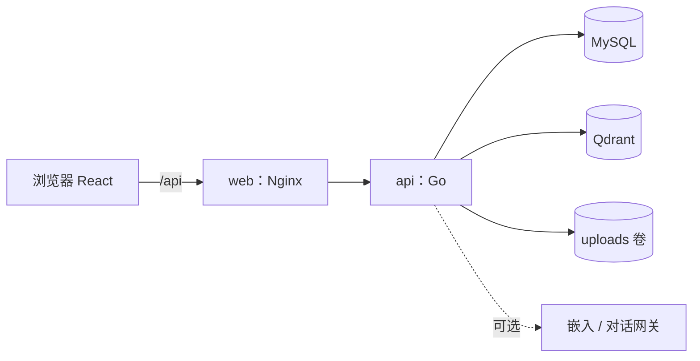

# CampusClaw 2.0 优化与扩展规划

基线是 `HanoFleet/teamwork` 的 `main`，内容与 `HanoFleet/campusclaw` 相同。本文只做规划，不改代码。实现时按 `AGENTS.md`，先写 OpenSpec change，再改代码。

---

## 1. 项目题目

**CampusClaw 2.0：可追溯的班级 AI 学习空间**

### 1.1 背景

现在的 CampusClaw 已经有：登录与班级隔离，教师上传 txt/md，本班关键字、向量、混合三种检索，以及带出处的问答；没有依据时不生成回答。

但它还只是一个「能检索的材料库」，日常用起来有几处明显的不便：

- 只收 txt 和 md。教师手里大多是 PDF、Word、PPT。
- 上传时同步建索引，文件大了要等很久，而且页面上看不到「什么时候能搜到」。
- 问答不能追问，刷新就丢。引用只能跳回材料列表，看不到依据在原文的哪个位置。
- 材料传上去之后就不能改。改一个错字也要删掉重传，学生之前看到的引用也跟着失效。
- 学生除了看材料和提问，没有别的事可做。班级里只有三个预置账号，学生没法自己加入。
- 讲义、作业、助手、技能四张表已经建好，但都只是占位，没有任何功能。

### 1.2 目标

围绕教师和学生的日常使用，补齐三块：

1. **材料库好用**：常见格式都能上传；能在线修改，并保留历史版本；传完能看到什么时候可以检索；引用能回到原文并高亮；学生读到哪里会被记住。
2. **问答可信又顺手**：能追问、能保存、逐字输出；每个 `[n]` 都能点开看依据；教师可以给本班配置专门的助手。
3. **班级动起来**：学生凭邀请码加入班级；教师按单元组织课程，布置作业和练习，并能看到每个学生的学习情况；学生收到通知、复习错题。

### 1.3 不变的底线

下面几条来自现有规约，新功能都不能破坏：

- 班级只来自服务端会话，请求里的 `class_id` 一律忽略。
- 跨班访问、访问不存在的 id、访问别人的私有数据，都返回同形 404。
- 没有依据就不生成。所有 AI 输出都带出处。
- Qdrant 和模型网关不对外暴露，密钥只放在服务端。
- 只用 Docker Compose 启动，只有 web 映射端口。`/health` 不查数据库。
- 上传要么全部写入，要么什么都不留。
- 不做超级管理员，不让 AI 给作业打分。

---

## 2. 主要功能

### 2.1 使用场景

**教师**：用邀请码把学生拉进班级 → 把几份 PDF、PPT 拖进材料页，看着它们从「索引中」变成「可检索」 → 把讲义编排进「第一单元」，并给本班配一个「数学答疑」助手 → 选中一份讲义点「生成练习」，改两道题后发布 → 布置一份作业 → 在「没答上的问题」里看到学生问了什么而资料里没有，补传一份材料，再顺手改掉讲义里的一个错字 → 在学情表里看到谁还没读讲义、哪道题错得最多 → 批改作业。

**学生**：凭邀请码注册，直接进入班级 → 首页看到待交作业和新公告 → 按学习路径打开第一单元的讲义，下次再打开会回到上次读到的位置 → 选中看不懂的一段点「讲解」，或点「就这份材料提问」 → 回答逐字出现，点 `[1]` 跳到原文高亮的那一段 → 做练习，提交后马上看到对错、解析和出处 → 错题进入错题本，之后复习 → 交作业，收到批改通知。

### 2.2 模块一：材料库

**多格式上传**

- 新增 `.pdf`、`.docx`、`.pptx`，原有的 `.txt` 和 `.md` 不变。
- PDF 的引用显示第几页，PPT 显示第几张幻灯片。Word 的标题样式会转成 Markdown 标题，按章节切分可以直接用。
- 遇到扫描件、加密或损坏的文件，当场说明原因，比如「这个 PDF 里没有可复制的文字，可能是扫描件」，不留下任何记录。

**拖拽批量上传与索引进度**

- 可以一次拖入多个文件。每个文件单独显示进度和状态：上传中、索引中、可检索、失败。
- 上传请求很快返回，索引在后台进行，页面自动刷新状态。失败的文件会写明原因，并可以重试。
- 重建索引期间，旧索引照常可以检索；新索引建好之后才替换。

**删除与回收站**

- 删除后几秒内可以撤销。删除的材料进入回收站，教师可以恢复，也可以彻底删除。
- 删除之后，学生的列表、检索和问答立即看不到这份材料。

**标签、排序与分页**

- 教师可以给材料打标签，比如「第一章」「实验」。列表可以按标签筛选，按上传时间或标题排序，并且分页显示。
- 教师可以重命名材料。

**在线编辑与版本历史**

- `.md` 和 `.txt` 可以在线编辑：左边编辑，右边预览。保存时可以写一句修改说明，保存后生成新版本，并自动重建索引。
- 两位教师同时编辑同一份材料时，后保存的人会收到冲突提示，可以先看差异，再决定覆盖还是放弃。
- PDF、Word、PPT 可以「替换文件」，同样生成新版本。
- 版本历史页可以对比任意两个版本的差异，也可以恢复到某个版本。恢复操作本身也会生成一个新版本，不会改写历史。

**原文定位与大纲**

- 材料详情页左侧显示标题大纲，点击可以跳转。
- 从检索结果或问答引用进入时，页面自动滚到对应段落并高亮，显示「切片 3 · 第 5 页」。
- 被引用的材料后来改过，引用处会提示「原文已更新」，并显示引用当时的摘录。

**阅读进度与收藏**

- 学生再次打开材料时，回到上次读到的位置。材料列表上标出已读和未读。
- 学生可以收藏材料。首页有「最近阅读」和「我的收藏」。

### 2.3 模块二：智能问答

**会话历史**

- 问答页左侧是自己的会话列表，可以新建、重命名、删除。刷新页面、换一台设备都不丢。
- 会话只有本人能看，教师也看不到学生的会话。

**流式回答**

- 先显示「找到 4 处依据」和依据卡片，再逐字输出回答。
- 生成过程中可以停止，也可以重新生成。
- 模型服务出错时，明确提示「服务暂时不可用」，不会说成「资料里没有」。

**追问与限定范围**

- 追问「那它的反例呢？」时，系统会结合上一轮理解问题再去检索。回答下方可以展开，看到实际用来检索的问题。
- 可以只针对某几份材料或某个标签提问。从材料详情页点「就这份材料提问」，范围默认就是这份材料。
- 空会话里显示几条推荐问题，根据本班材料的标题生成。

**引用角标**

- 回答里的 `[1]`、`[2]` 显示成角标。鼠标悬停预览摘录，点击后打开原文并高亮对应段落。
- 服务端会校验编号，超出依据数量的编号直接去掉。如果模型一处出处都没标，回答上方提示用户自行核对。

**班级助手**

- 教师可以为本班配置助手：名称、头像（emoji）、开场白、回答风格（简洁、详细、引导式提问）、推荐问题。
- 一个班可以有多个助手，比如「数学答疑」和「实验安全」。每个助手可以限定只用某些标签下的材料。
- 学生新建会话时选择用哪个助手。不管用哪个助手，都遵守「先检索、没依据不生成」。

**学习技能**

- **总结要点**：对选中的材料生成分条要点，每条都带出处。
- **概念讲解**：在材料页选中一段文字，点「讲解」，系统用更浅显的话解释这一段，并给出出处。
- **生成练习**：从材料生成选择题、判断题、填空题草稿，交给教师修改后发布（见模块三）。
- 教师可以决定每个助手开放哪些技能。
- 选中的材料还没有可用切片时，直接说明，不调用模型。

**回答反馈与「没答上的问题」**

- 每条回答都可以标「有用」或「没用」。
- 教师可以看到本班最近没有命中依据的问题和被标为「没用」的回答，相同的问题合并计数。这里只显示问题本身，不显示是谁问的。

### 2.4 模块三：班级与教学互动

**加入班级与账号**

- 教师生成邀请码，可以设置有效期和使用次数，也可以随时撤销。学生打开邀请链接，填写用户名和口令后，直接进入该班。
- 邀请码无效、过期、已撤销、已用完，都给出同一种提示，不区分具体原因。
- 教师也可以上传 CSV，批量创建学生账号。上传后先预览，逐行标出新建、重名、格式错误，确认后才创建；初始口令只在导入结果里出现一次。
- 用户可以修改自己的口令。教师可以重置本班学生的口令，学生下次登录时必须先改口令。

**课程单元与学习路径**

- 教师把材料、练习、作业编排进单元，比如「第一单元 函数」，并设定顺序和发布时间（可以定时发布）。
- 学生看到的学习路径是一列单元卡片。每张卡片显示完成度：读了几份材料、练习做了没有、作业交了没有。
- 未发布的单元学生看不到，按 id 访问也是 404。
- 单元页里可以「就本单元提问」，提问范围限定为这个单元里的材料。

**作业**

- 教师发布作业，内容包括说明（Markdown）、关联材料、截止时间，以及是否允许迟交。
- 学生在线写答案，或者上传文件；截止前可以重新提交。
- 教师逐份打分、写评语，可以导出成绩表（CSV）。
- 学生只能看到自己的提交。

**练习与错题本**

- 教师可以手动出题，也可以用「生成练习」得到草稿后再修改。题型有单选、多选、判断、填空，每道题都关联出处。
- 学生提交后立即判分，这时才能看到正确答案、解析和出处链接。在此之前，答案不会发到浏览器。
- 答错的题自动进入错题本。复习时重新作答，连续答对两次就标记为已掌握。

**公告与通知**

- 教师可以发布公告。
- 作业发布、作业快到截止、作业批改完成、练习发布、新公告，都会产生通知。顶栏显示未读数。

**学情统计**

- 教师可以看到本班每个学生的已读材料数、作业提交情况和得分、练习平均分、最近活跃时间，并且可以导出 CSV。
- 每份材料显示有多少学生读过，每道练习题显示正确率，方便找出大家普遍没掌握的知识点。
- 学生只能看到自己的数据。

**首页待办**

- 学生首页显示：待交的作业（按截止时间排序）、没做完的练习、需要复习的错题、最新公告、最近阅读。
- 教师首页显示：待批改的作业、索引失败的材料、最近没答上的问题，以及学情概览（谁还没交作业、谁最近没登录）。

### 2.5 体验与质量的通用改进

- **页面框架**：左侧导航包括首页、学习路径、材料、问答、作业、练习、通知，教师另有「班级管理」；窄屏时变成底部标签栏。保留现有的北大红主色和深浅主题。
- **全局搜索**：现有的 Ctrl/⌘ + K 命令面板扩展成全局搜索，同时搜材料、单元、作业、练习和常用操作，可以用键盘上下选择。
- **统一反馈**：加载时显示骨架屏，空列表告诉用户下一步可以做什么，出错时提供重试按钮。
- **不丢草稿**：登录过期时弹出登录框，重新登录后回到原页面，正在写的作业和问题不会丢。
- **顺手修掉现有问题**：

| 问题 | 位置 |
| --- | --- |
| 限流取 `X-Forwarded-For` 第一段，客户端伪造这个头就能绕过登录锁定 | `httpapi/server.go`、`nginx.conf` |
| 远程嵌入的向量维度写死为 256，换成真实模型后写不进 Qdrant | `embed/embed.go` |
| 重建索引先删后建，重建期间这份材料检索不到 | `retrieval/index.go` |
| 前端把令牌存进 `localStorage`，页面脚本能读到 | `frontend/src/api.ts` |
| 正式页面里留着演示隔离用的 `class_id: 999` 和伪造的 `system` 消息 | `App.tsx`、`Ask.tsx` |

---

## 3. 技术方案

### 3.1 总体架构

链路不变：浏览器 → Nginx → Go → MySQL / Qdrant，模型网关可选。Compose 仍然是 web、api、db、qdrant 四个服务。api 镜像多装一个 `poppler-utils`，用来抽取 PDF 文字。



后端继续用 Go 标准库，不加第三方库。前端继续用 React、Vite、react-markdown，不引入 UI 框架。

### 3.2 后端新增模块

```text
backend/internal/
  extract/        txt、md、pdf、docx、pptx 的文字抽取，以及页码表
  indexer/        后台索引队列：排队、重试、先建后换
  library/        版本、回收站、标签、阅读进度、收藏
  conversation/   会话、消息、追问改写、流式输出、出处校验
  assistant/      班级助手配置、内置技能（总结、讲解、出题）
  teaching/       邀请码、批量导入、单元、作业、提交、练习、错题、公告、通知
  stats/          首页待办与学情统计
  db/migrations/  按版本编号的建表与改表脚本
```

现有的 `auth`、`chunk`、`retrieval`、`httpapi` 保留，并做相应扩展。

### 3.3 关键设计

**上传时同步抽取，索引放到后台**

上传请求里先抽取文字：PDF 用 `pdftotext`，有超时和输出上限；Word 和 PPT 用标准库 `archive/zip` 和 `encoding/xml` 解析。抽取成功后，文件、材料行、知识库行在同一个事务里写入，所以「要么全有，要么全无」仍然成立。

之后把材料 id 放进进程内的索引队列，立即返回 201。后台 worker 负责切片，并按每批 32 条调用嵌入，状态写在 `materials.index_status` 里。api 重启时，把仍处于 `pending` 或 `indexing` 的材料重新排队，沿用现在启动补齐索引（`Backfill`）的做法。前端在有材料未完成时每 2 秒刷新一次状态。

扫描件这类失败要当场告诉教师，所以抽取不放进后台。

**重建索引先建后换**

`knowledge_chunks` 增加 `generation` 列。重建时，新切片用新的 generation 写入，向量也写进 Qdrant。全部成功后，在一个事务里把新切片标为 `ready` 并删除旧切片，最后再删除旧向量。中途失败就只删掉新写入的部分，旧索引原样可用。

**引用位置一律指向原文**

现在 `custom` 策略的偏移是相对预处理后文本的。改为在预处理时记录下标映射，切片的起止位置一律存原文下标。PDF 和 PPT 在抽取时记录每页的起始位置，切片据此算出页码。前端按码点切分原文后再高亮，避免 emoji 这类字符错位。

出处（消息里的引用、题目的出处）存的是材料 id、版本号和原文区间，而不是切片 id，因为重建索引之后切片 id 会变。前端发现版本号比材料当前版本旧，就提示「原文已更新」。

**在线编辑用版本号防冲突**

每次保存都在 `material_versions` 里新增一行，内容是正文（或替换后的文件名）、编辑人和修改说明。保存请求要带上开始编辑时的版本号；服务端在事务里比对，如果版本号已经不是最新的，就返回 409 和最新内容，前端显示两边的差异，让教师决定。保存或恢复之后，材料重新进入索引队列；新索引建好之前，旧索引照常可用（沿用先建后换）。差异对比在前端计算。

**流式回答用 SSE**

新接口 `POST /api/conversations/{id}/messages` 以 SSE 返回，事件依次是 `citations`（依据）、若干 `delta`（文字片段）、`done`。Go 用 `http.Flusher` 推送，响应头带 `X-Accel-Buffering: no`，Nginx 就不会缓冲。浏览器用 `fetch` 读取流。用户点停止时连接断开，服务端随之取消对模型的请求。

没有依据时，只发空的依据列表和固定文案，不调用模型。原有的 `POST /api/ask` 保持不变，curl 和验收脚本照常可用。

**每个 AI 能力都有本地实现**

| 能力 | 本地实现（离线、结果固定，便于验收） | 接课程网关时 |
| --- | --- | --- |
| 回答 | 现有的摘录式回答，按句切开逐段推送 | `/chat/completions`，开启 `stream` |
| 追问改写 | 问句很短或含「它、这个」时，拼上上一轮的问题 | 让模型改写成一个完整问题，只用于检索 |
| 总结要点 | 按标题结构和句子位置挑选原句 | 带编号依据的提示词 |
| 概念讲解 | 返回选中段落及其前后相邻的句子 | 带编号依据的提示词，要求用浅显的话解释 |
| 生成练习 | 从关键句挖空做填空题，从陈述句做判断题 | 要求输出 JSON，服务端校验格式，失败重试一次 |
| 回答风格 | 简洁取 1 句，详细取 3 句，引导式在末尾追加一个思考问题 | 写进系统提示 |

没有课程网关的密钥也能完整演示，验收脚本也能跑通。

**助手只改说话方式，不改规则**

助手配置存在 `assistants` 表里，内置技能的清单存在 `skills` 表里，助手用一个列表记录自己开放了哪些技能。助手的风格只影响提示词里的说话方式，不改变「先检索、没依据不生成」的流程。助手的标签范围在服务端和用户自己选的范围取交集，所以范围只会更小，不会更大。

**单元只负责编排**

课程单元用 `handouts` 表，单元里的条目放在 `handout_items`，每条记录类型（材料、练习、作业）和顺序。学生查询时只返回已发布、并且发布时间已到的单元。单元只是把东西排在一起，不改变材料本身的可见性；单元里的练习和作业仍然各自按自己的发布状态显示。

**学情直接从业务表聚合**

学情统计直接查阅读进度、作业提交、练习作答和会话消息这几张表，不另建统计表。查询条件固定带会话班级，并且只统计本班学生。

**批量导入**

CSV 单次最多 200 行。初始口令由服务端随机生成，bcrypt 哈希并发计算；明文只出现在本次响应返回的结果 CSV 里，不入库，不写日志。导入的学生首次登录时必须先改口令。

**私有数据与答案保护**

- 会话、消息、错题、阅读进度、收藏只对本人可见，其他人访问一律 404。
- 作业提交和练习记录对本人和本班教师可见。
- 学生端的题目接口不返回答案和解析，提交并由服务端判分之后才返回。

**邀请码**

邀请码是 8 位随机码，数据库只存它的 SHA-256 哈希，同时记录班级、有效期、使用次数上限和已用次数。注册时在一个事务里创建用户并计数，新用户的班级来自邀请码，不来自请求。注册接口按 IP 限速。

**数据库迁移**

现在建表靠 `CREATE TABLE IF NOT EXISTS`，没办法加列。改为把按版本编号的 SQL 文件打包进程序，用 `schema_migrations` 表记录哪些已经执行过。第一版脚本就是现有的建表语句，所以已有的数据库不用清空就能升级。

**修复现有问题**

- Nginx 改为传 `X-Real-IP $remote_addr`。Go 只在请求来自 web 容器时才信这个值，否则用连接地址。失败计数改存 MySQL，api 重启也不会清零。
- 嵌入维度从 `EMBEDDING_DIM` 读取，Qdrant 集合名带上维度。
- 前端不再保存令牌，只靠 HttpOnly Cookie。登录接口仍然返回令牌，供 curl 和脚本使用。
- 删掉页面里的 `class_id: 999` 和伪造的 `system` 消息。隔离测试只放在 `verify.py` 里。

### 3.4 数据表

| 表 | 新增或修改 | 用途 |
| --- | --- | --- |
| `schema_migrations` | 新增 | 记录已执行的迁移版本 |
| `users` | 修改 | 增加显示名、「必须修改口令」标记、最近登录时间 |
| `login_failures` | 新增 | 登录失败计数，替代内存计数 |
| `class_invites` | 新增 | 邀请码哈希、班级、有效期、使用次数 |
| `materials` | 修改 | 增加文件类型、页数、当前版本号、索引状态、失败原因、`deleted_at` |
| `material_versions` | 新增 | 每个版本的正文或文件、编辑人、修改说明 |
| `knowledge_entries` | 修改 | 增加页码表；正文是当前版本的原文或抽取出的文字 |
| `knowledge_chunks` | 修改 | 增加 `generation`、起止页码；起止位置改为原文下标 |
| `tags`、`material_tags` | 新增 | 材料标签 |
| `material_reads`、`favorites` | 新增 | 阅读位置和是否读完、收藏 |
| `conversations`、`messages` | 新增 | 会话（记录所用助手）；消息里存依据、是否命中、实际检索的问题 |
| `message_feedback` | 新增 | 有用、没用 |
| `assistants` | 修改 | 从占位表变成正式的班级助手：名称、开场白、风格、推荐问题、标签范围、开放的技能 |
| `skills` | 修改 | 从占位表变成内置技能清单：总结要点、概念讲解、生成练习 |
| `handouts` | 修改 | 从占位表变成课程单元：简介、顺序、发布状态、发布时间 |
| `handout_items` | 新增 | 单元里的材料、练习、作业及顺序 |
| `assignments` | 修改 | 从占位表变成正式的作业表：说明、截止时间、状态 |
| `submissions` | 新增 | 作业提交、分数、评语 |
| `quizzes`、`quiz_questions` | 新增 | 练习和题目，题目存答案、解析、出处 |
| `quiz_attempts`、`wrong_items` | 新增 | 作答记录、错题本 |
| `announcements`、`notifications` | 新增 | 公告、通知 |

所有新表都带 `class_id`（`skills` 是全局清单，除外），并建索引。原来的讲义、作业、助手、技能四张占位表，这一轮都变成正式功能。

### 3.5 新增接口

| 方法与路径 | 说明 |
| --- | --- |
| `POST /api/register` | 凭邀请码注册 |
| `POST /api/me/password` | 修改口令 |
| `GET`、`POST`、`DELETE /api/class/invites` | 管理邀请码（教师） |
| `POST /api/class/members/{id}/reset-password` | 重置学生口令（教师） |
| `POST /api/class/members/import` | CSV 批量导入，带 `?dry_run=1` 时只预览（教师） |
| `PATCH`、`DELETE /api/materials/{id}`，`POST /api/materials/{id}/restore`，`GET /api/trash` | 重命名、打标签、删除、恢复、回收站 |
| `PUT /api/materials/{id}/content`、`POST /api/materials/{id}/file` | 在线编辑（带版本号，冲突返回 409）、替换文件（教师） |
| `GET /api/materials/{id}/versions`、`POST /api/materials/{id}/versions/{v}/restore` | 版本历史、恢复到某个版本 |
| `PUT /api/materials/{id}/progress`、`PUT`、`DELETE /api/materials/{id}/favorite` | 阅读进度、收藏 |
| `GET /api/materials` | 增加标签、排序、分页参数，返回索引状态 |
| `POST /api/materials/{id}/reindex` | 改为后台执行，返回 202 |
| `POST /api/search` | 增加 `scope`，限定材料或标签 |
| `GET`、`POST`、`PATCH`、`DELETE /api/conversations` | 会话 |
| `POST /api/conversations/{id}/messages` | 提问，以 SSE 流式返回 |
| `POST /api/messages/{id}/feedback` | 反馈 |
| `GET /api/assistants`，`POST`、`PUT`、`DELETE /api/assistants/{id}` | 班级助手（所有人可读，教师可写） |
| `POST /api/skills/summary`、`POST /api/skills/explain`、`POST /api/skills/quiz` | 总结要点、概念讲解、生成练习 |
| `GET /api/insights/unanswered` | 没答上的问题（教师） |
| `/api/units`、`PUT /api/units/{id}/items`、`POST /api/units/{id}/publish` | 课程单元、编排、发布 |
| `/api/assignments`、`/api/assignments/{id}/submission`、`/api/submissions/{id}/grade` | 作业、提交、批改 |
| `/api/quizzes`、`/api/quizzes/{id}/attempts`、`/api/wrong-items` | 练习、作答、错题本 |
| `/api/announcements`、`/api/notifications` | 公告、通知 |
| `GET /api/dashboard` | 首页待办 |
| `GET /api/stats/students`、`GET /api/stats/students.csv`、`GET /api/stats/materials`、`GET /api/stats/questions` | 学生学情、材料阅读、题目正确率（教师） |
| `GET /api/quick-search?q=` | 全局搜索：材料、单元、作业、练习 |

按 id 访问的接口都先读出整行，再核对班级和归属，不满足就返回与「不存在」相同的 404。

### 3.6 前端

- 把 629 行的 `App.tsx` 拆开：`pages/` 下放首页、学习路径、材料、问答、作业、练习、通知、班级管理、设置，`components/` 下放通用组件，比如提示条、对话框、骨架屏、空状态、上传队列、引用角标、原文高亮视图、Markdown 编辑器（文本框加实时预览）、版本差异视图。
- 新增的路由有：`/`、`/units`、`/units/:id`、`/materials/:id`、`/materials/:id/edit`、`/materials/:id/versions`、`/ask/:conversationId`、`/assignments/:id`、`/quizzes/:id`、`/wrong-book`、`/notifications`、`/class`（教师：成员、邀请码、导入、助手、学情）、`/register`、`/settings`。
- 运行时只新增一个依赖 `diff`，用来计算版本差异。
- 请求统一走现有的 `api()`：401 时弹出重新登录框，503 时显示「服务暂时不可用」并提供重试。
- 作业答案、问答输入框、正在编辑的材料，草稿都自动存进 `localStorage`，提交后清除。
- 阅读位置在滚动停下 2 秒后上报一次，不随每次滚动发请求。

### 3.7 安全

- 上传：扩展名白名单之外再校验文件头。PDF 必须以 `%PDF-` 开头；docx 和 pptx 必须是合法的 zip，并限制解压后的大小和文件数。下载一律按附件返回，不在页面内直接打开。
- Markdown 继续不渲染原始 HTML，另外加上 CSP 响应头。
- 所有修改数据的请求都核对 `Origin`。提问和生成练习按用户限制频率。
- 材料里的文字只作为依据交给模型，客户端传来的 `system` 消息继续丢弃。

### 3.8 测试与验收

- **`verify.py`**：保留现有全部检查，并按模块新增场景。新增的每一类资源（材料版本、单元、助手、会话、作业提交、练习作答、错题、阅读进度、通知）都要测三种情况：其他班的 id、同班其他学生的 id、不存在的 id，三次响应必须完全相同。另外要测：学生调用教师接口（编辑、导入、助手配置、学情）返回 403；未发布的单元返回 404；练习提交前拿不到答案。
- **Go 单元测试**：文件抽取（用 docx、pptx、pdf 小样本）、偏移映射、先建后换的重建、编辑冲突、本地技能和回答风格、练习判分、邀请码、CSV 导入校验。
- **端到端测试**：用 Playwright 跑三条主路径，每条在桌面宽度和手机宽度下各跑一次：
  - 邀请注册 → 上传 PDF → 等到可检索 → 提问 → 点引用跳到原文；
  - 编辑材料 → 旧引用提示「原文已更新」→ 恢复到旧版本；
  - 编排单元 → 发布练习和作业 → 学生作答、提交 → 错题本 → 教师批改 → 学情表更新。
- **手动检查清单**：手机宽度、深色主题、只用键盘操作，主路径各走一遍。
- 全部用本地模式运行，不需要任何密钥。

### 3.9 需要修改的现有规约

| 现有条款 | 改成 |
| --- | --- |
| 上传扩展名只允许 `.txt`、`.md` | 增加 `.pdf`、`.docx`、`.pptx`，并校验文件头 |
| `knowledge_entries.body` 是上传原文 | 是当前版本的原文，或从文件中抽取出的文字；教师编辑或替换文件后生成新版本，并重建索引 |
| 重建索引先删除旧切片，再写入新切片 | 新索引建好后再替换旧的；接口改为后台执行 |
| `custom` 策略的偏移相对预处理后的文本 | 偏移一律指向原文 |
| 问答接口不做流式 | `/api/ask` 保持不变；新的会话接口支持流式 |
| 讲义、作业、助手、技能四张占位表不提供业务接口 | 四张表都提供业务接口：讲义表用作课程单元，助手表存班级助手，技能表存内置技能 |
| 规约只写了 Cookie 会话 | 补写已经实现的 Bearer 令牌，网页端不保存令牌 |
| `openspec/config.yaml` 里写着不引入 JWT 和作业批改 | 删去这两项，保留「不做超级管理员」 |

这些改动都写进各自 change 的 delta，不直接改已经归档的规约。

### 3.10 实施顺序

拆成三个 OpenSpec change，每个对应一个模块：

1. **`upgrade-material-library`**：数据库迁移机制、页面框架、现有问题修复，以及模块一。其他两个 change 都建立在它之上，所以先做。
2. **`add-conversational-qa`**：模块二。
3. **`add-class-teaching`**：模块三。练习功能可以先用手动出题；等第 2 个 change 的「生成练习」完成后再接上。课程单元要编排材料、练习和作业，学情统计要读这些数据，所以这两项放在这个 change 的最后。

第 2、3 个 change 可以并行开发。每个 change 都按「提案 → 评审 → 实现 → 跑 verify → 归档」的顺序推进。

---

## 4. 分工

按课程要求分三个角色：制定规约、开发系统、项目验收。三块里开发的工作量最大，所以角色一和角色三在完成本职之外，各兼任一部分开发。兼任的内容要写进个人贡献记录。

### 4.1 角色与成员

| 角色 | 姓名 | 学号 | 本职 | 兼任 |
| --- | --- | --- | --- | --- |
| 角色一：制定规约 | （待填） | （待填） | 写三个 OpenSpec change 的提案、设计、规约和任务清单；实现过程中规约需要改的，由他先改 | 开发模块三的一部分 |
| 角色二：开发系统 | （待填） | （待填） | 按规约实现底座、模块一、模块二；保证 `main` 分支随时能用 Compose 启动、主路径能走通；合并代码前做代码审查 | — |
| 角色三：项目验收 | （待填） | （待填） | 按规约写验收脚本和检查清单，逐条判定是否完成，写验收记录 | 开发模块三的另一部分 |

### 4.2 各角色的本职

**角色一：制定规约**

- 每条需求都写清五件事：谁能做，做什么，不做什么，失败时怎样（状态码、提示文案、数据有没有残留），用什么证据判定（哪条 verify、哪个 curl 响应、哪张截图）。
- 交付 `openspec/changes/<change>/` 下的 `proposal.md`、`design.md`、`specs/*/spec.md`、`tasks.md`。第 3.9 节列出的现有规约改动，都写成 delta。
- 实现中发现规约含糊或者写错了，先改 delta，再改代码（`AGENTS.md` 的规则）。

**角色二：开发系统**

- 只实现写进规约的行为。一个 task 做完、对应的 verify 通过之后，才勾选 `tasks.md`。
- 保留实现过程中的依据：提交信息写清改了什么、对应哪条 task；做实现时才定下来的决定，补进 `design.md`。
- 每次合并之前，Compose 能正常启动，现有的 verify 全部通过。

**角色三：项目验收**

- 拿同一份规约逐条核对四类内容：功能有没有做到；失败路径有没有按规约处理；权限和班级隔离是否成立；证据是否齐全。
- 只认可能复现的证据：`verify.py` 的输出、Playwright 的结果、curl 的响应、截图。「已经实现了」这类说法不算数，包括 AI 工具自己声称完成。
- 交付扩展后的 `verify.py`、Playwright 用例、手动检查清单，以及每个 change 的验收记录（`docs/verification.md`）。不通过的条目退回给开发者，写明是哪条场景、实际结果是什么。

### 4.3 开发怎么分

| 开发内容 | 谁来写 | 谁来验收 |
| --- | --- | --- |
| 底座：数据库迁移、页面框架、现有问题修复 | 角色二 | 角色三 |
| 模块一：材料库 | 角色二 | 角色三 |
| 模块二：智能问答 | 角色二 | 角色三 |
| 模块三：加入班级与账号、作业、公告与通知 | 角色一 | 角色三 |
| 模块三：课程单元、练习与错题本、学情统计、首页待办 | 角色三 | 角色一 |

原则是谁写的代码不由谁验收。角色三写的那部分，由角色一按同一份规约验收。

开发跟不上时，按下面的顺序调整：

1. 把模块二的「班级助手」「学习技能」从角色二移给角色一。
2. 还不够的话，把模块一的「标签、排序与分页」「阅读进度与收藏」移给角色三。

调整之后同样遵守「谁写的代码不由谁验收」，并同步更新上面这张表和个人贡献记录。

### 4.4 协作流程

每个 change 都按同一个流程走：

1. 角色一写好提案和规约，三人一起评审，确认没有歧义后定稿。
2. 角色三根据定稿的规约，先写验收场景（`verify.py` 里的检查、Playwright 用例）。这时功能还没实现，验收应该是不通过的。
3. 开发者按 `tasks.md` 实现，每完成一条就跑一次对应的验收。
4. 角色三逐条验收，写验收记录；不通过的退回开发者。
5. 全部通过后，角色一把 delta 合进 `openspec/specs/`，然后归档这个 change。

三个 change 可以错开进行：角色二开发第 1 个 change 时，角色一写第 2、3 个 change 的规约，角色三写第 1 个 change 的验收。

### 4.5 个人贡献记录

- 每人在 `docs/个人贡献记录.md` 里写自己的部分：负责的规约条目、对应的提交号、验收记录。兼任的开发内容要单独写明。
- 提交信息里注明对应的 change 和 task 编号，这样贡献记录能和提交历史一一对上。
